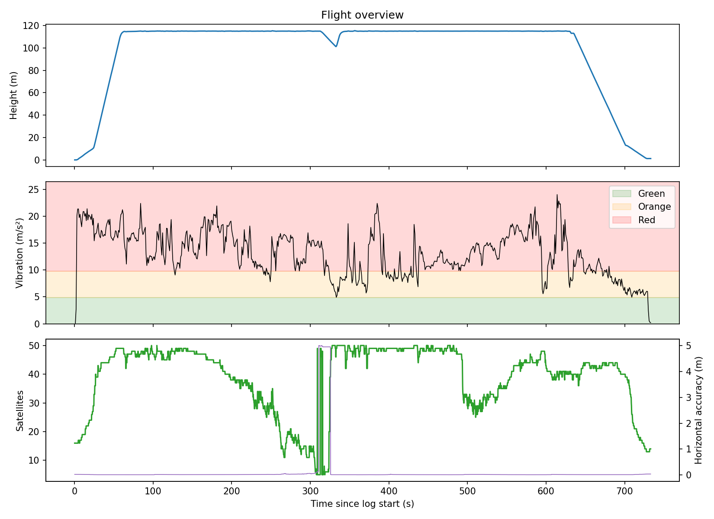

# Drone Flight Log Analyzer

A C++17 command-line tool that reads PX4 drone flight logs (the binary ULog format) and flags problems during flight: high vibration, GPS dropouts, fast descents, and low battery. The ULog parser is written from scratch with no outside parsing libraries.



## Findings on a real flight

I tested it on a public 12-minute flight log from PX4 Flight Review. The aircraft was a multicopter with RTK GPS that flew to about 115 m.

- Sustained high vibration: The vibration metric was in PX4 Flight Review's red zone (above 9.81 m/s²) for 78% of the time in the air: 18 separate events totaling about 544 seconds, with a peak of 24 m/s².
- A GPS dropout: Between about 308 and 326 seconds, the satellite count fell from about 39 to 5, and horizontal accuracy went from about 0.1 m to 5 m. Two separate checks flagged the same window.
- Battery and descent rate stayed within limits: The lowest pack voltage was 22.6 V, about 3.77 V per cell.

The analyzer shows that the vibration metric was high. Finding the physical cause (propeller balance, mounting, a loose part) would take a look at the raw accelerometer data or the aircraft itself.

## How it works

**1. Parser (`ulog_parser.cpp`)**
- Checks the 16-byte file header and its magic bytes.
- Walks the stream of messages, each with a 3-byte header giving its size and type.
- Builds a "blueprint" for each message type from the format (`F`) messages, and links ID numbers to blueprints from the subscription (`A`) messages.
- Works out the byte offset of every field, including arrays, nested types, and padding, then decodes only the fields that were requested from each data (`D`) message.
- Reads little-endian values byte by byte, so it gives the same result on any CPU.
- Handles logs that end in the middle of a message (common after a crash or power loss) and never reads past the end of a buffer.

**2. Checks (`checks.cpp`)**
- Only checks readings taken while the drone was in the air, using a binary search on the land detector's readings to match up topics logged at different rates.
- Groups bad readings less than 2 seconds apart into one event, and drops one-reading blips.
- Keeps every limit in one `Thresholds` struct.

**3. Report and export (`report.cpp`)**
- Prints a summary table by check, then every event in time order.
- With `--csv`, exports each topic and all events to CSV files.

## Checks and limits

| Check | Limit | Source |
|---|---|---|
| Very high vibration | above 9.81 m/s² | PX4 Flight Review's red zone |
| No 3D GPS fix | fix type below 3 | PX4 fix types |
| Few satellites | below 6 | Adjustable default |
| Poor GPS accuracy | above 3 m | Adjustable default |
| Fast descent | above 3 m/s | Adjustable default |
| Low cell voltage | below 3.5 V per cell | Common LiPo rule of thumb |
| Low battery | below 20% | Adjustable default |

## Build and run

**Requirements:** a C++17 compiler, CMake 3.16 or newer, and Ninja. Tested with GCC 16 (MSYS2) on Windows.

```bash
cmake -S . -B build -G Ninja
cmake --build build
./build/flight_log_analyzer path/to/log.ulg
```

To get a log, open [review.px4.io](https://review.px4.io), browse public flights, and download the `.ulg` file.

| Option | What it does |
|---|---|
| `--csv` | Writes each topic and all events to CSV files in `output/` |
| `--topics` | Lists every topic in the log and how many readings it has |

To make the chart, run the analyzer with `--csv`, then:

```bash
python tools/plot_flight.py
```

## Tests

20 unit tests written with GoogleTest. They build small fake ULog files by hand, where the right answer is known, and check that the parser and checks get it right. They cover bad files, float and negative integer decoding, padding and nested formats, logs cut off mid-message, event grouping, and the in-air check.

```bash
ctest --test-dir build --output-on-failure
```

## Project layout

```
src/
  ulog_parser.hpp/.cpp   Reads ULog files and decodes requested fields
  checks.hpp/.cpp        Flight checks and the in-air lookup
  report.hpp/.cpp        Summary table, event list, CSV export
  main.cpp               Command-line program
tests/                   GoogleTest unit tests
tools/plot_flight.py     Makes the chart from the CSV output
docs/                    Chart used in this README
```
